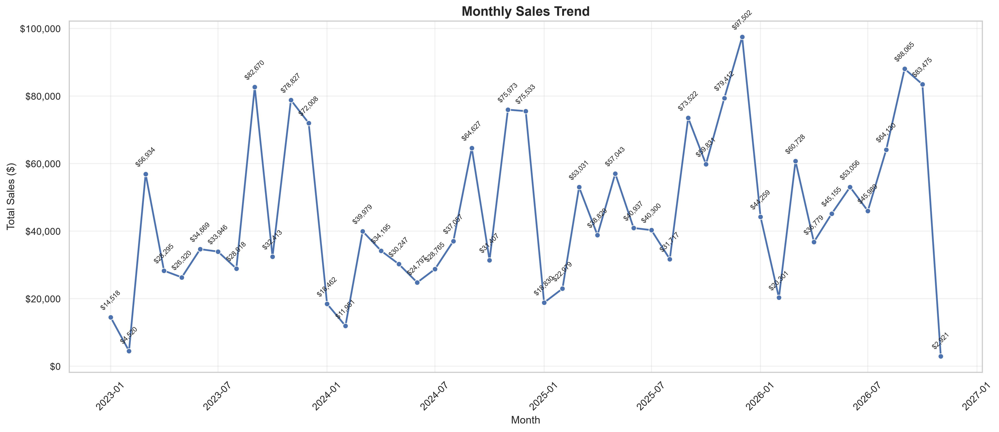
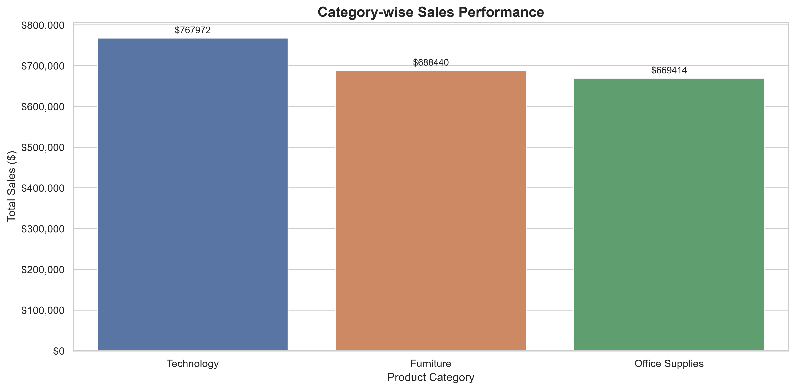
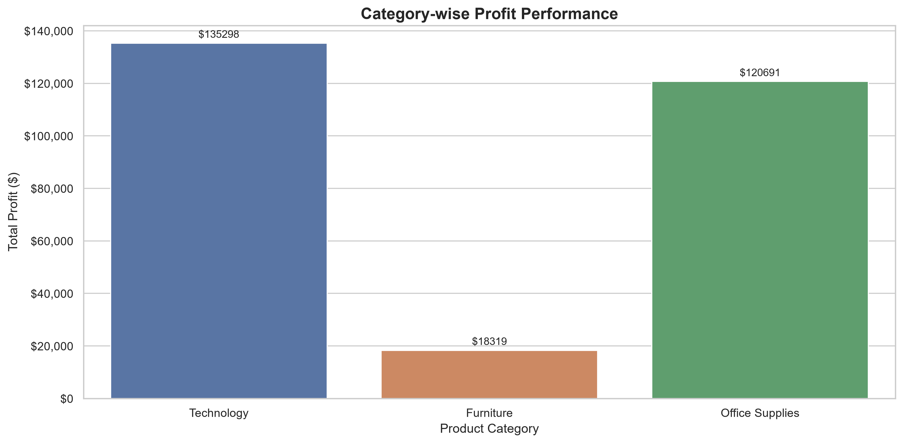
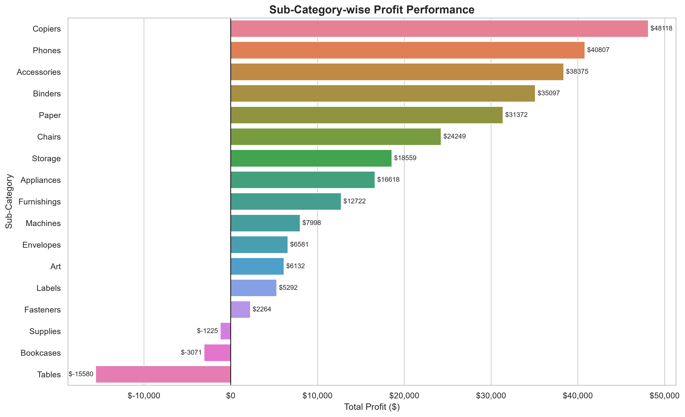
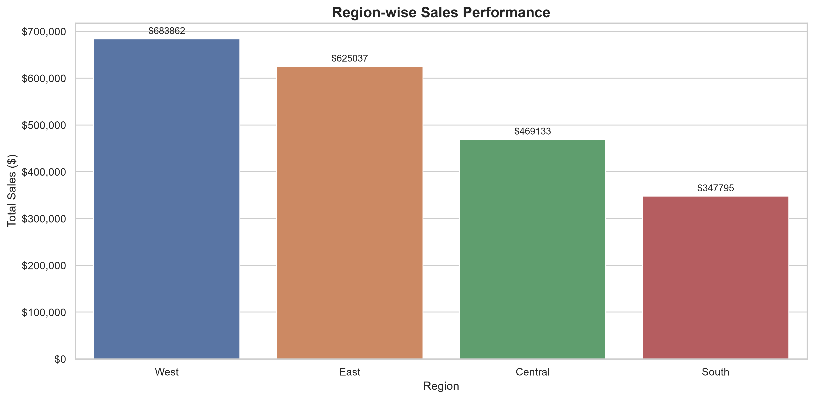
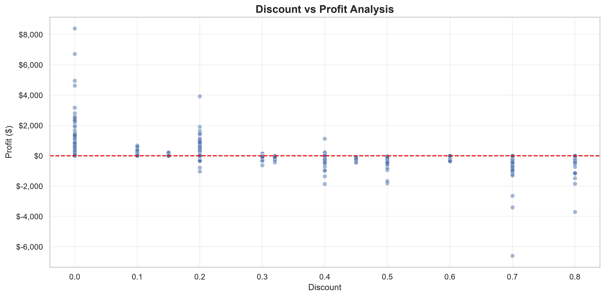

# Sales Data Analysis Using Python and SQL

## Project Overview

Analyzed historical sales data using Python and SQL to identify sales trends, product performance, customer behavior, regional performance, and profitability patterns.

## Objectives

- Analyze overall sales and profitability.
- Identify top-performing and loss-making products.
- Evaluate customer segments and purchasing behavior.
- Analyze regional and time-based sales trends.
- Investigate discounts and shipping performance.
- Generate business insights and recommendations.

## Dataset

- Historical Records: 9,256
- Columns: 28
- Orders: 4,615
- Customers: 803
- Date Range: January 3, 2023 – November 1, 2026

- [Download sales.csv](https://github.com/Anil-Vana/Sales-Data-Analysis/blob/main/data/raw/sales.csv)


## Data Processing

The cleaned and historical datasets are generated during data preprocessing and analysis.

These files are not included in the repository because of their size. Run the notebook to regenerate them from the original dataset.


## Technologies

- Python
- Pandas
- NumPy
- Matplotlib
- Seaborn
- MySQL
- MySQL Workbench
- Jupyter Notebook

## Project Structure

```text
sales data analysis/
├── data/
│   ├── raw/
│   │   └── sales.csv
│   └── processed/
│       ├── cleaned_sales.csv
│       └── historical_sales.csv
├── notebooks/
│   └── sales_analysis.ipynb
├── sql/
│   └── sales_analysis.sql
├── visualizations/
├── reports/
│   └── Sales_Analysis_Report.md
├── README.md
├── requirements.txt
└── .gitignore
```

## Key Business Metrics

| Metric | Value |
|---|---:|
| Total Sales | 2,125,826.05 |
| Total Profit | 274,307.38 |
| Total Quantity | 35,017 |
| Total Orders | 4,615 |
| Total Customers | 803 |
| Average Order Value | 460.63 |
| Profit Margin | 12.90% |

## SQL vs Pandas Validation

The overall business metrics were compared between Pandas and MySQL to validate the results.

| Metric | Pandas Value | MySQL Value | Difference (SQL - Pandas) |
|---|---:|---:|---:|
| Total Sales | 2,125,826.2465 | 2,125,826.05 | -0.1965 |
| Total Profit | 274,307.7809 | 274,307.38 | -0.4009 |
| Total Quantity | 35,017 | 35,017 | 0 |

**Note:** Minor differences in Sales and Profit arise because individual records were rounded to two decimal places during MySQL import using `DECIMAL(12,2)`. Total Quantity matches exactly between both systems.

## Key Findings

- Technology generated the highest sales and profit.
- Office Supplies achieved the highest category profit margin.
- Tables recorded the largest subcategory loss.
- Consumer customers generated the highest sales.
- Corporate customers achieved the highest profit margin.
- West was the strongest region.
- September consistently showed strong sales performance.
- Higher discounts were associated with negative profitability.

## Analysis

- Data cleaning and preprocessing
- Exploratory data analysis
- Product and customer analysis
- Regional and time-based analysis
- Discount and shipping analysis
- SQL business analysis
- SQL and Pandas result validation
- Data visualization

## Visualizations

### 1. Monthly Sales Trend



### 2. Category-wise Sales



### 3. Category-wise Profit



### 4. Subcategory-wise Profit



### 5. Region-wise Sales



### 6. Discount vs Profit



## Setup

## Clone Repository

```bash
git clone https://github.com/Anil-Vana/Sales-Data-Analysis.git
cd Sales-Data-Analysis
```

### Install Dependencies

```bash
pip install -r requirements.txt
```

### Run Python Analysis

Open the [Sales Analysis Notebook](notebooks/sales_analysis.ipynb) in Jupyter Notebook or VS Code and execute the cells.

## Database Setup

- Database: `sales_analysis`
- Table: `sales`
- Database System: MySQL

Create the database:

```sql
CREATE DATABASE sales_analysis;
USE sales_analysis;
```

The historical dataset is available at:

`data/processed/historical_sales.csv`

The dataset was imported into MySQL using Python and MySQL Connector.

## SQL Analysis

Execute the queries in [sales_analysis.sql](sql/sales_analysis.sql) using MySQL Workbench.

## Project Report

For detailed analysis, methodology, visualizations, SQL and Pandas validation, and business recommendations, see:

[Sales Analysis Report](reports/Sales_Analysis_Report.md)

## Conclusion

This project demonstrates practical skills in Python, SQL, data cleaning, exploratory data analysis, visualization, and business insight generation. It provides insights into sales performance, profitability, customer behavior, and business operations to support data-driven decision-making.
