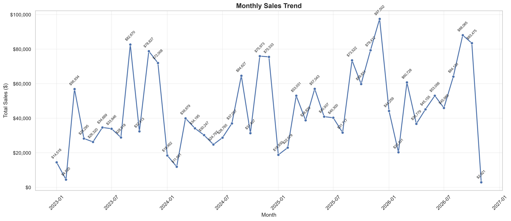
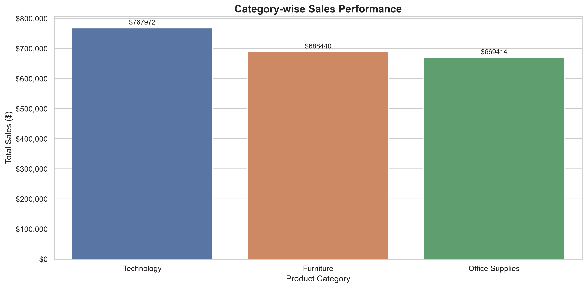
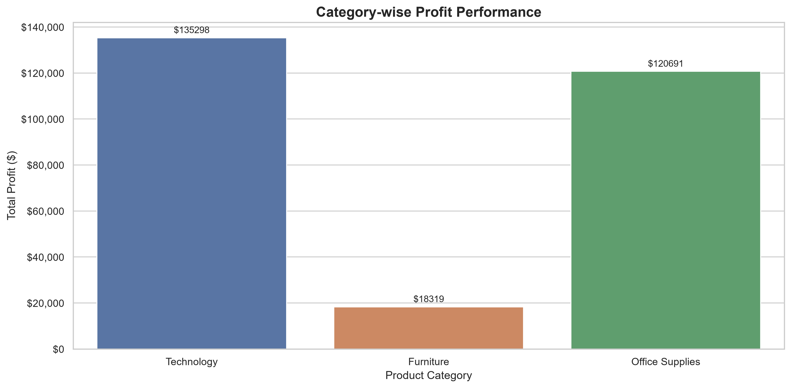
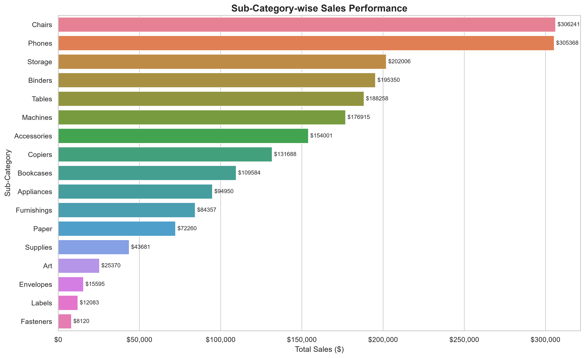
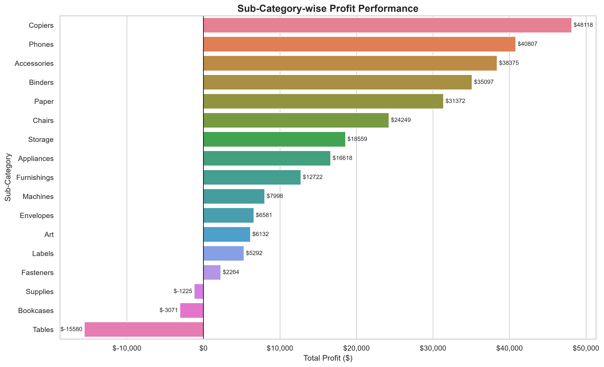
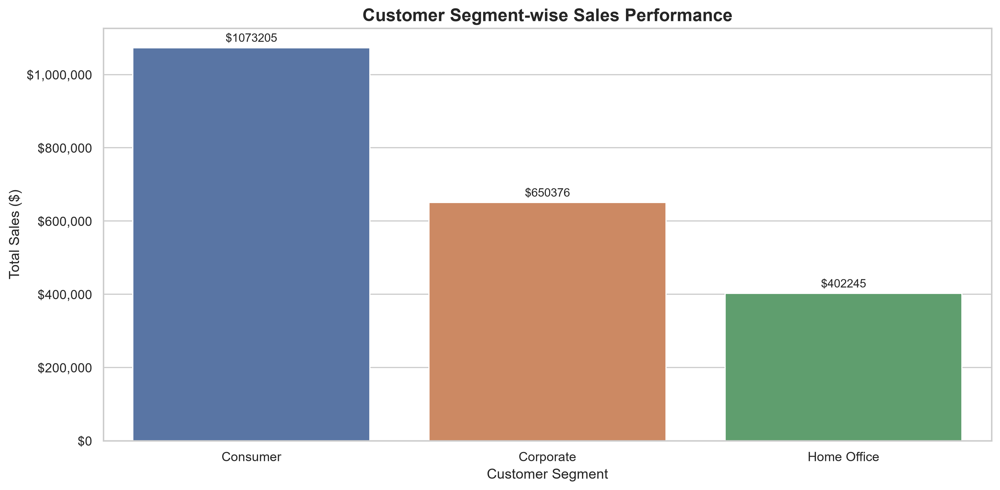
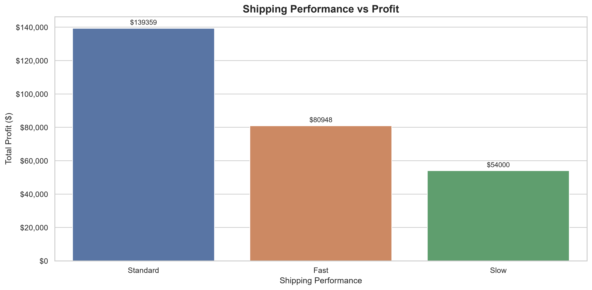
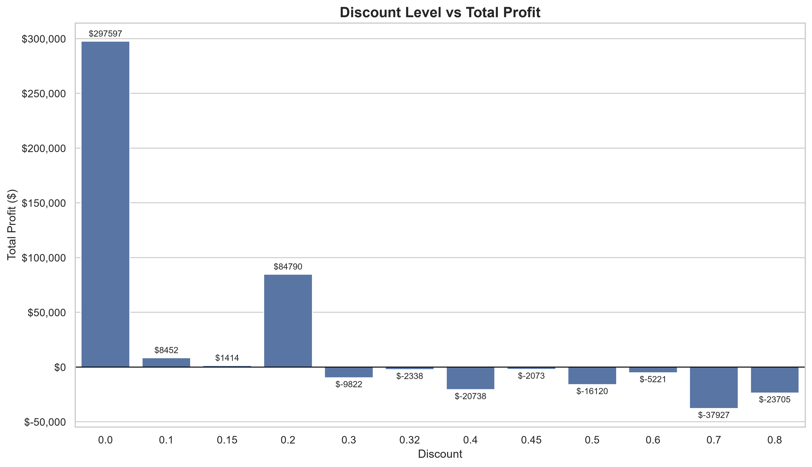

# Sales Data Analysis Using Python and SQL

## 1. Project Overview

### Project Title
Sales Data Analysis Using Python and SQL

### Project Description
This project focuses on analyzing historical sales data using Python and SQL to identify business trends, evaluate sales performance, understand profitability, and generate actionable business insights.

Python is used for data cleaning, preprocessing, exploratory data analysis, and visualization. MySQL is used to perform structured queries and analyze sales performance across products, customers, regions, and time periods.

The analysis helps identify profitable product categories, loss-making products, customer purchasing patterns, regional performance, and the relationship between discounts and profitability.

### Project Objectives
- Analyze overall sales and profit performance.
- Identify top-performing and loss-making products.
- Evaluate customer segments and purchasing behavior.
- Analyze regional and state-wise sales performance.
- Understand monthly and yearly sales trends.
- Investigate the relationship between discounts and profitability.
- Analyze shipping performance.
- Generate meaningful business insights and recommendations.

### Tools and Technologies
- Python
- Pandas
- NumPy
- Matplotlib
- Seaborn
- MySQL
- MySQL Workbench
- Jupyter Notebook
- Visual Studio Code

## 2. Dataset Description and Data Preparation

### 2.1 Dataset Description

The project uses a historical sales dataset containing information about customer orders, products, sales, quantities, discounts, profits, and shipping details.

The original dataset contains **10,194 records and 21 columns**.

The dataset includes the following information:

- Order information: Row ID, Order ID, Order Date, Ship Date, Ship Mode
- Customer information: Customer ID, Customer Name, Segment
- Location information: Country/Region, City, State/Province, Postal Code, Region
- Product information: Product ID, Category, Sub-Category, Product Name
- Sales information: Sales, Quantity, Discount, Profit

### 2.2 Data Cleaning and Preprocessing

The dataset was processed using Python and Pandas.

The following preprocessing operations were performed:

- Checked the dataset for missing values.
- Checked for duplicate records.
- Converted Order Date and Ship Date into datetime format.
- Created Shipping Duration to calculate delivery time.
- Extracted Order Year and Ship Year.
- Extracted Order Month and Order Month Name.
- Created Order Quarter.
- Classified shipping performance using Shipping Performance.
- Prepared a cleaned dataset for further analysis.

### 2.3 Historical Data Preparation

The dataset was filtered to retain historical records and exclude future-dated records.

The historical dataset contains:

- **9,256 records**
- **28 columns**
- No missing values
- No duplicate records

The historical Order Date ranges from **January 3, 2023, to November 1, 2026**.

### 2.4 Data Export

The processed historical dataset was exported into CSV format and used for SQL analysis.

The cleaned and historical datasets were organized within the project data directory for reproducibility and further analysis.

**Note on Decimal Rounding:** Minor differences between Python and MySQL totals arise because Sales and Profit values were stored in MySQL using `DECIMAL(12,2)`, rounding each record to two decimal places during import. MySQL totals reflect the imported database values.

### 2.5 SQL and Pandas Validation

The overall business metrics were compared between Pandas and MySQL to validate the results.

| Metric | Pandas Value | MySQL Value | Difference (SQL - Pandas) |
|---|---:|---:|---:|
| Total Sales | 2,125,826.2465 | 2,125,826.05 | -0.1965 |
| Total Profit | 274,307.7809 | 274,307.38 | -0.4009 |
| Total Quantity | 35,017 | 35,017 | 0 |

Sales and Profit show minor differences because individual records were rounded to two decimal places during MySQL import using `DECIMAL(12,2)`. Total Quantity matches exactly between both systems.

The comparison confirms that Pandas and MySQL produce consistent overall business metrics, with minor decimal rounding differences in Sales and Profit.

## 3. Exploratory Data Analysis (Python)

### 3.1 Overview

Exploratory Data Analysis (EDA) was performed using Python to understand sales patterns, product performance, customer behavior, and profitability.

Pandas and NumPy were used for data analysis, while Matplotlib and Seaborn were used to create visualizations.

### 3.2 Overall Sales and Profit Analysis

Analyzed total sales, total profit, total quantity, number of orders, and customer count to understand the overall business performance.

### 3.3 Time-Based Analysis

Analyzed yearly and monthly sales trends to identify changes in sales performance over time and understand seasonal patterns.

### 3.4 Product Performance Analysis

Evaluated sales and profit across product categories and subcategories to identify high-performing and loss-making products.

### 3.5 Customer Segment Analysis

Compared sales and profitability across Consumer, Corporate, and Home Office customer segments.

### 3.6 Regional Analysis

Analyzed sales and profit across geographical regions to identify strong and weak regional performance.

### 3.7 Discount and Profit Analysis

Examined the relationship between discount levels and profitability to identify discount categories associated with losses.

### 3.8 Shipping Performance Analysis

Analyzed shipping duration and shipping performance to understand delivery efficiency and business contribution.

### 3.9 Visualizations Created

The following visualizations were generated and saved in the project:

- Overall Sales and Profit
- Yearly Sales Trend
- Monthly Sales Trend
- Category-wise Sales
- Category-wise Profit
- Subcategory-wise Sales
- Subcategory-wise Profit
- Customer Segment Sales
- Customer Segment Profit
- Region-wise Sales
- Region-wise Profit
- Discount vs Profit
- Shipping Performance
- Shipping Performance Profit
- Discount Level vs Profit

### 3.10 Visualization Storage

All generated visualization files are stored in the `visualizations` directory for reference and presentation.
### 3.11 Visualization Gallery

#### 3.11.1 Overall Sales and Profit

#### 3.11.2 Yearly Sales Trend

#### 3.11.3 Monthly Sales Trend

#### 3.11.4 Category-wise Sales

#### 3.11.5 Category-wise Profit

#### 3.11.6 Subcategory-wise Sales

#### 3.11.7 Subcategory-wise Profit

#### 3.11.8 Customer Segment Sales

#### 3.11.9 Customer Segment Profit

#### 3.11.10 Region-wise Sales

#### 3.11.11 Region-wise Profit

#### 3.11.12 Discount vs Profit

#### 3.11.13 Shipping Performance

#### 3.11.14 Shipping Performance Profit

#### 3.11.15 Discount Level vs Profit

## 4. SQL Analysis and Business Insights

### 4.1 Overview

MySQL was used to perform structured analysis on the historical sales dataset. SQL queries were written to evaluate business performance across products, customers, regions, and time periods.

### 4.2 Overall Business Performance

The analysis identified the following business metrics:

| Metric | Value |
|---|---:|
| Total Sales | 2,125,826.05 |
| Total Profit | 274,307.38 |
| Total Quantity | 35,017 |
| Total Orders | 4,615 |
| Total Customers | 803 |
| Average Order Value | 460.63 |
| Profit Margin | 12.90% |

### 4.3 Category-wise Analysis

- Technology generated the highest sales and profit.
- Office Supplies achieved the highest quantity sold and profit margin.
- Furniture recorded the lowest overall profit margin.

### 4.4 Subcategory Analysis

- Chairs generated the highest subcategory sales.
- Copiers generated the highest subcategory profit.
- Tables recorded the largest subcategory loss.
- Binders achieved the highest quantity sold.

### 4.5 Customer Segment Analysis

- Consumer customers generated the highest sales and total profit.
- Corporate customers achieved the highest profit margin.
- Home Office customers recorded the highest average order value.

### 4.6 Regional Analysis

- West generated the highest sales and profit contribution.
- East was the second-largest contributor.
- Central recorded comparatively weak profitability.
- South generated the lowest sales contribution.

### 4.7 Product Performance Analysis

- Canon imageCLASS 2200 Advanced Copier was the highest-selling and highest-profit product.
- Cubify CubeX 3D Printer recorded the largest product loss.
- High sales volume did not always translate into high profitability.

### 4.8 Discount Analysis

- Transactions without discounts generated the highest total profit.
- Higher discount categories were associated with negative profitability.
- Discounts of 30% and above recorded negative total profit in the analyzed dataset.

### 4.9 Shipping Analysis

- Standard shipping generated the highest sales and profit.
- Fast shipping had the shortest average shipping duration.
- Slow shipping had the longest average shipping duration.

### 4.10 State and City Analysis

- California recorded the highest sales among the analyzed states.
- New York City generated the highest sales among the analyzed cities.
- Several high-sales states and cities also recorded negative profitability.

### 4.11 Customer Purchase Analysis

- Eugene Hildebrand placed the highest number of distinct orders among the analyzed customers.
- Clay Ludtke generated the highest sales among the top repeat-order customers.
- Repeat purchases did not always result in positive profit.

## 5. Key Findings

The analysis produced the following important findings:

- Technology was the strongest category in terms of sales and profit.
- Office Supplies achieved the highest category profit margin.
- Furniture profitability was relatively low, with Tables recording the largest subcategory loss.
- Consumer customers contributed the highest revenue and total profit.
- Corporate customers achieved the highest profit margin among customer segments.
- West was the strongest region in terms of sales and profit.
- Central region showed comparatively weaker profitability.
- September consistently recorded strong monthly sales across multiple years.
- Higher discounts were associated with negative profitability.
- Some high-sales products and customers generated losses.
- Repeat purchases did not always guarantee profitability.

## 6. Business Recommendations

Based on the analysis, the following business recommendations are proposed:

### 6.1 Improve Product Profitability
- Focus on profitable products such as Copiers and selected Technology products.
- Review pricing and cost structures for loss-making products.
- Evaluate Tables and Bookcases to identify opportunities to improve profitability.

### 6.2 Optimize Discount Strategies
- Review high-discount transactions before offering large discounts.
- Introduce discount policies based on product profitability.
- Monitor profit margins alongside sales growth.

### 6.3 Strengthen Regional Performance
- Maintain strong performance in the West region.
- Investigate profitability challenges in the Central region.
- Analyze loss-making states such as Texas, Pennsylvania, Illinois, and Ohio.

### 6.4 Improve Customer Profitability
- Focus on profitable customer relationships.
- Evaluate customer-level sales and profit together.
- Develop customer retention strategies for valuable customers.

### 6.5 Support Seasonal Planning
- Use monthly sales trends to support inventory planning.
- Prepare inventory and marketing activities ahead of strong sales periods.
- Monitor incomplete yearly data before making annual comparisons.

## 7. Conclusion

This project demonstrated how Python and SQL can be used together to perform comprehensive sales data analysis.

Python was used for data cleaning, preprocessing, exploratory data analysis, and visualization. MySQL was used to perform structured business analysis and extract meaningful insights from historical sales records.

The project identified important patterns in product performance, customer behavior, regional sales, discount strategies, and profitability.

Overall, this analysis provides a foundation for data-driven decision-making and demonstrates practical skills in Python, Pandas, NumPy, SQL, data visualization, and business analytics.